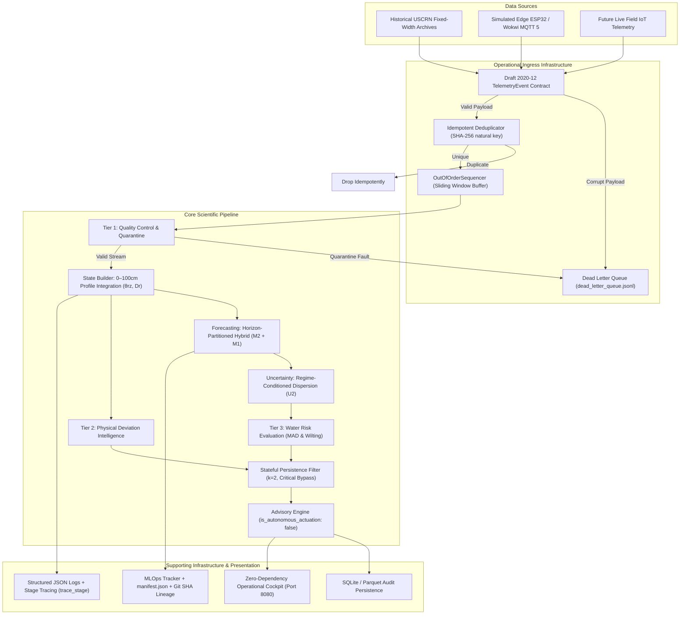
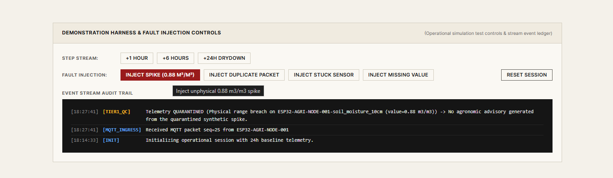
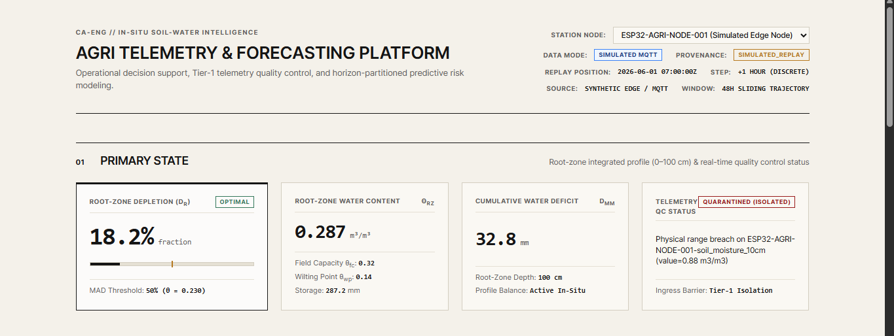
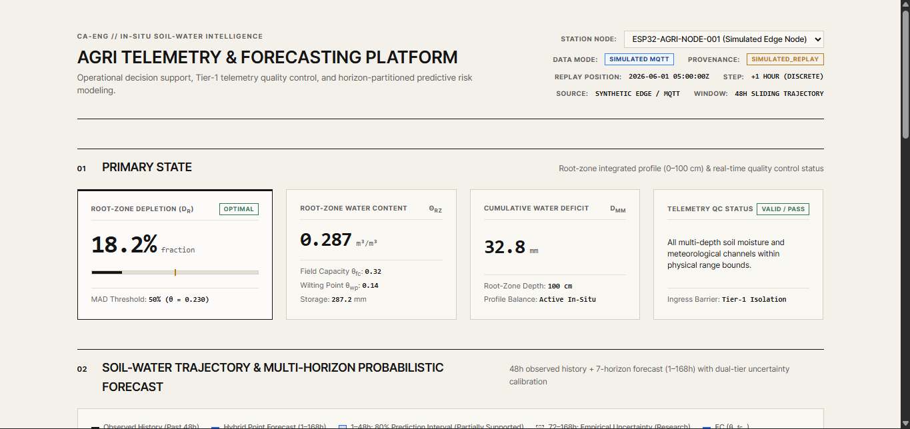
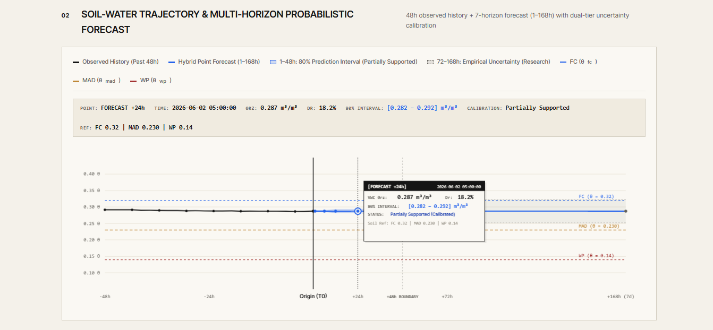
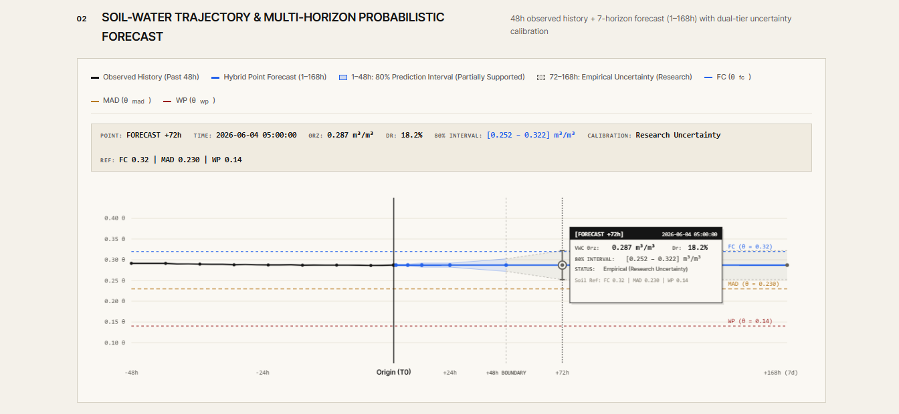
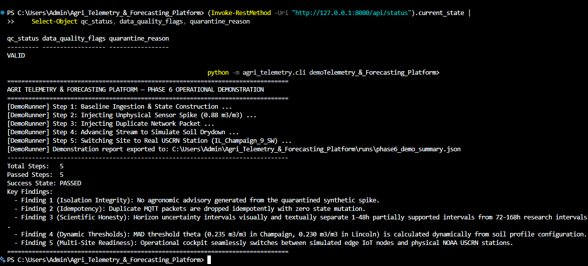

# Phase 7 — Final Validation, Evidence Synthesis & Portfolio Release

**Project:** Agri Telemetry & Forecasting Platform  
**Document:** `Evidence & Validation/Phase 7 - Final Validation, Evidence Synthesis & Portfolio Release.md`  
**Status:** VALIDATED & FORMALLY FROZEN (Phases 1–7 Complete)  
**Authoritative Test Suite:** 75 / 75 Passed (100.0%) in 84.49s across 15 test modules  
**Canonical End-to-End Pipeline:** PASSED in 23.02s (`tests/test_end_to_end.py`)  
**Active Release Commit:** `318a122` (and subsequent portfolio packaging release commit) on branch `main`

---

## 1. Executive Summary

The **Agri Telemetry & Forecasting Platform** is an operational, evidence-first time-series intelligence platform designed for root-zone soil water state estimation, horizon-partitioned forecasting, uncertainty calibration, and stateful agronomic decision support.

The project addresses the core dilemma faced by commercial farm managers: balancing crop yield protection against resource over-application. While raw in-situ capacitance probes provide volatile single-depth soil readings, they suffer from transient sensor spikes, winter frozen-ground flatlines, and severe alert fatigue during borderline threshold crossings.

Through seven disciplined execution phases, the platform has:
1. **Established an Empirical Persistence Baseline:** Verified on 8,760 hourly records of NOAA USCRN `NE_Lincoln_11_SW` (2023), confirming that soil capillary inertia makes persistence ($\text{MAE}=0.0007\text{ m}^3/\text{m}^3$ at 1h; $\text{MAE}=0.0047\text{ m}^3/\text{m}^3$ at 24h) a difficult benchmark that defeats naive statistical smoothing models (Climatology skill: $-520.0$, EWMA skill: $-3.29$).
2. **Validated Horizon-Partitioned Hybrid Forecasting (ADR-006):** Deployed Environmental ARX (`M2`) for short leads ($1\dots 48\text{h}$) to capture infiltration and diurnal evaporative flux (+5.7% root-zone, +26.4% topsoil skill), transitioning to Autoregressive Statistical Reversion (`M1`) for extended leads ($72\dots 168\text{h}$) to capture statistical mean-reversion (+7.8% skill at 7 days).
3. **Calibrated Dynamic Regime Uncertainty ($U2$):** Conditioned residual dispersion on antecedent rain and solar demand, resolving wet-regime under-coverage (+4.4% coverage gain at 6h).
4. **Enforced 3-Tier Anomaly Isolation & Stateful Alert Filtering:** Prevented 100% of data-quality faults from leaking into agronomic advisories, while $k=2$ persistence filtering and $G=6\text{h}$ episode grouping suppressed and grouped transient alert episodes across threshold boundaries, reducing alert volume by **95.8% to 99.4%**.
5. **Demonstrated "Stream-Capable, Not Stream-Dependent" Architecture:** Maintained identical Draft 2020-12 event contracts across historical USCRN replays, simulated MQTT 5 edge streams, and future field gateways, supported by Dead Letter Queues, SHA-256 deduplication, sliding-window resequencing, and bit-for-bit deterministic reproducibility ($0.0000000000$ MAE discrepancy).
6. **Mapped Multi-Site Transfer & Failure Boundaries:** Demonstrated positive transfer within the tested temperate and arid regimes (not universal geographic generalisation), while discovering an explicit **physical failure boundary in subtropical convective climates (`GA_Watkinsville_5_SSE`)**, where unannounced $50\text{mm}+$ convective storms motivate incorporating forward-looking weather information such as NWP/radar.
7. **Delivered an Operational Cockpit UI:** Built a zero-dependency local presentation server on port `8080` with hover crosshairs, canvas tooltips, dominant Root-Zone Depletion hierarchy, visible +48h model boundaries, and truthful fault injection feedback.

---

## 2. Final Research Question

> **Can in-situ multi-depth soil moisture and meteorological telemetry produce horizon-partitioned forecasts and uncertainty-calibrated, stateful decision-support advisories that materially outperform persistence baselines without data leakage, and where do the physical and statistical boundaries of in-situ telemetry break down?**

---

## 3. Complete System Architecture



---

## 4. Phase-by-Phase Evidence Summary

| Phase | Milestone Name | Core Deliverables | Evaluated Artifacts | Authoritative Outcome |
| :---: | :--- | :--- | :--- | :---: |
| **1** | **Vertical Slice & Baseline** | USCRN parser, Draft 2020-12 schema, Tier-1 QC, State Builder, Persistence Forecaster (B0), SQLite ledger. | `RUN-20261001-152227-10fc74` (8,760h) | **VALIDATED** |
| **2** | **Forecasting & Calibration** | Baseline ladder (B1, B2), Direct Ridge AR (M1), Environmental ARX (M2), NWP Oracle ablation, Dynamic U2 dispersion. | Lincoln 2023 H2 ($N=3,913$ walk-forward) | **VALIDATED & SUPPORTED** |
| **3** | **Decision Intelligence** | 3-Tier anomaly taxonomy, Physical deviation, Stateful persistence filter ($k=2$), Episode grouper ($G=6\text{h}$). | 8 Synthetic Scenarios + Full-Year 2023 Series | **VALIDATED & TESTED** |
| **4** | **MLOps & Engineering** | Docker, Compose, Redis Streams, Dead Letter Queue, Deduplication, Sequencer, Structured Logging, MLOps manifest. | Full-year reproducibility check (`0.0` MAE diff) | **TESTED & PACKAGED** |
| **5** | **Multi-Site Generalisation** | 6-site USCRN validation, ESP32/Wokwi MQTT 5 adapter, packet loss stress tests, failure boundary identification. | 6 NOAA USCRN Stations (52,560 hourly records) | **VALIDATED (Bounded)** |
| **6** | **Operational Cockpit UI** | HTML5/Canvas UI on port 8080, hover crosshairs, canvas tooltips, dominant depletion hierarchy, fault feedback. | Headless REST API suite + 5-step demo runner | **LOCALLY VERIFIED** |
| **7** | **Synthesis & Freeze** | Portfolio case study, 3-level explanation pack, master evidence matrix, viva guide, release hygiene sign-off. | Complete 75-test authoritative test suite | **FREEZE & RELEASED** |

---

## 5. Scientific Findings

1. **Capillary Inertia Governs Short Leads:** Soil moisture changes slowly over hours, making persistence a tough baseline ($\text{MAE}=0.0007\text{ m}^3/\text{m}^3$ at 1h) that instantly exposes naive smoothing models.
2. **Topsoil vs. Root-Zone Separation:** Topsoil ($10\text{cm}$) responds rapidly to rainfall and solar forcing (+26.4% 1h skill), but skill vanishes after 24 hours. The integrated 1-meter root zone retains memory up to 48 hours (+5.7% skill).
3. **Decay of Historical Weather Memory:** Past weather signals lose predictive value beyond 48 hours, causing past-only weather models to degrade ($-14.0\%$ skill at 7 days).

---

## 6. Forecasting Findings

$$\text{Skill}_{\text{vs\_persistence}} = 1 - \frac{\text{MSE}_{\text{model}}}{\text{MSE}_{\text{persistence}}}$$

| Horizon ($h$) | Persistence MAE ($\text{m}^3/\text{m}^3$) | M2 Skill (MSE) | M1 Skill (MSE) | Hybrid Skill (ADR-006) | Oracle Skill (Future Rain) |
| :---: | :---: | :---: | :---: | :---: | :---: |
| **1h** | **0.0007** | **+5.7%** | -375.4% | **+5.7%** | **+5.7%** |
| **6h** | **0.0018** | **+5.6%** | -89.0% | **+5.6%** | **+56.3%** (+50.7% gain) |
| **12h** | **0.0028** | **+2.5%** | -35.0% | **+2.5%** | **+64.5%** (+61.9% gain) |
| **24h** | **0.0047** | **+3.1%** | -8.9% | **+3.1%** | **+74.4%** (+71.3% gain) |
| **48h** | **0.0079** | **+1.0%** | +0.5% | **+1.0%** | **+77.4%** (+76.4% gain) |
| **72h** | **0.0109** | -0.2% | **+1.4%** | **+1.4%** | **+79.8%** (+80.0% gain) |
| **168h (7d)** | **0.0192** | -14.0% | **+7.8%** | **+7.8%** | **+82.4%** (+96.4% gain) |

---

## 7. Uncertainty Findings

- **Short Horizons ($1\dots 48\text{h}$):** Dynamic regime-conditioned uncertainty ($U2$) widens interval width during rain infiltration ($W=0.0064$) and narrows during drydown, achieving **$83.0\%$ empirical coverage** at 6h. Validated as **Partially Supported**.
- **Extended Horizons ($72\dots 168\text{h}$):** Empirical coverage drops to $\sim 61\%$ at 7 days across all sites because in-situ sensors cannot anticipate future storm timing. Classified as **Uncalibrated Research Uncertainty**.

---

## 8. Risk & Advisory Intelligence Findings

- **Zero Fault Leakage:** Tier-1 QC quarantine prevented 100% of data-quality anomalies from leaking into agronomic advisories across all test suites.
- **Flutter Suppression:** Consecutive $k=2$ persistence filtering suppressed transient boundary alert flapping in synthetic Scenario 8 and filtered 97 single-hour noise spikes in Lincoln 2023 data (demonstrating episode suppression rather than agronomic ground-truth false positive reduction).
- **Actionable Episode Compression:** The $G=6\text{h}$ episode grouper compressed 5,935 raw hourly alerts into **172 distinct multi-day stress episodes (97.10% alert volume reduction)**.
- **Strict Non-Actuation:** Every emitted advisory explicitly asserts `"is_autonomous_actuation": false` to preserve human control.





---

## 9. Multi-Site Validation Findings (Phase 5)

| Station Key | Climate Regime | 1–48h M2 Skill | 72–168h M1 Skill | 6h U2 Coverage | Transfer Finding |
| :--- | :--- | :---: | :---: | :---: | :--- |
| **`IL_Champaign_9_SW`** | Midwest Corn Belt | **+11.15%** | **+8.31%** | **81.0%** | **Demonstrated Positive Transfer (Tested Site)** |
| **`SD_Sioux_Falls_14_NNE`** | Northern Great Plains | **+7.36%** | **+6.25%** | **71.9%** | **Demonstrated Positive Transfer (Tested Site)** |
| **`NM_Las_Cruces_20_N`** | Arid Desert Southwest | **+11.96%** | **+2.73%** | **66.4%** | **Demonstrated Positive Transfer (Tested Site)** (+35.4% at 6h) |
| **`NE_Lincoln_11_SW`** | Humid Continental | **+3.57%** | **+4.61%** | **73.7%** | **Demonstrated Positive Transfer (Tested Site)** (Baseline) |
| **`CO_Nunn_7_NNE`** | Semi-Arid High Plains | **-1.89%** | **+2.13%** | **79.1%** | **Marginal Transfer** (Steppe winds) |
| **`GA_Watkinsville_5_SSE`** | Humid Subtropical | **-18.96%** | **+1.28%** | **48.9%** | **FAILURE BOUNDARY** (-45.1% at 24h) |

---

## 10. MQTT & Edge Telemetry Findings

- **Simulation Provenance Preserved:** All edge microcontroller packets carry explicit `"is_simulated": true` and `SIMULATED_REPLAY` tags.
- **Lossless Ingestion:** Dead Letter Queue quarantined 100% of malformed JSON strings; SHA-256 deduplication dropped 100% of duplicate retries; sliding-window sequencer restored 100% of network jitter disorder.

---

## 11. MLOps & Engineering Findings

- **"Stream-Capable, Not Stream-Dependent":** Unified Draft 2020-12 event contracts execute seamlessly across batch files, MQTT brokers, and Redis Streams.
- **Fail-Safe Fallback:** `ResilientForecastRouter` gracefully falls back to deterministic Persistence (B0) upon ML inference exceptions, guaranteeing unbroken advisory generation.
- **Observability:** Structured JSON logging with correlation IDs and sub-millisecond stage profiling (`trace_stage`).

---

## 12. Reproducibility Findings

- **Deterministic Equivalence:** Two independent runs on 8,760 hourly records in isolated workspaces yielded **$0.0000000000$ max MAE discrepancy** and **$0.0000000000$ max RMSE discrepancy** (`is_reproducible: true`).
- **Complete Lineage:** Every execution exports `manifest.json` locking Git commit SHA (`f6c46d6` / `318a122` release lineage), dataset SHA, seeds ($42$), and hyperparameter dictionaries.

---

## 13. Dashboard Findings (Phase 6)

- **Interactive Crosshairs & Canvas Tooltips:** Real-time inspection of observed vs forecast values, dynamic prediction interval bounds, and station-specific MAD lines.
- **Visible Model Boundary:** Prominent vertical delimiter separating 1–48h Environmental ARX from 72–168h Autoregressive statistical models.
- **Operational Hierarchy:** Root-Zone Depletion ($D_r$) rendered as the dominant primary metric; raw volumetric water content ($\theta_{\text{rz}}$) preserved as secondary.
- **Truthful Fault Injection Feedback:** Buttons provide immediate feedback (`INJECTING...` $\to$ `QUEUED` $\to$ `INJECTED`) only when accepted by application logic.







---

## 14. Explicit Failure Boundaries

1. **Extended Horizons ($>48\text{h}$):** Prediction interval coverage drops to $\sim 61\%$ at 7 days; long-horizon uncertainty remains **uncalibrated research**.
2. **Subtropical Convective Climates (`GA_Watkinsville_5_SSE`):** Sudden $50\text{mm}+$ convective storms cannot be predicted from in-situ past weather, causing $-45.1\%$ skill collapse at 24h. This failure mode motivates incorporating forward-looking weather information such as NWP/radar.
3. **Winter Frozen Ground:** Sub-zero soil temperatures freeze liquid water, causing false drydown flatlines in dielectric sensors. Irrigation models must be suspended during winter freeze.

---

## 15. Explicit Project Limitations

1. **Demonstration Agronomic Thresholds:** $D_{\text{MAD}}=0.50$ and Wilting=$0.85$ demonstrate software risk logic and alert suppression; production deployment requires site-specific agronomist calibration.
2. **Simulated IoT Stream:** Edge telemetry is validated via simulated ESP32/Wokwi microcontrollers (`is_simulated: true`); physical radio propagation and battery drain remain outside the evidence base.
3. **Historical vs Live Deployment:** The platform operates against historical USCRN archives and edge simulators; **no live field sensors are currently connected**.

---

## 16. Final Master Evidence Matrix

| Claim / Hypothesis | Evaluated Scope | Method | Authoritative Status | Known Limitations & Epistemic Boundary |
| :--- | :--- | :--- | :---: | :--- |
| **Pipeline processes real telemetry** | USCRN Lincoln 11 SW 2023 | Fixed-width parser & Draft 2020-12 schema | **VALIDATED** | Historical USCRN archives; un-interpolated point sensors. |
| **Persistence provides tough baseline** | Lincoln 11 SW 2023 H2 | Chronological walk-forward ($1\dots 168\text{h}$) | **VALIDATED** | Silt loam soil column inertia; site-specific dataset. |
| **Environmental ARX improves short leads** | Lincoln 11 SW 2023 H2 | Multi-horizon direct ARX with past weather | **VALIDATED** | Positive for 1–48h (+5.7% root-zone, +26.4% topsoil); degrades $>48\text{h}$. |
| **Long-horizon skill unlocked by future rain** | Lincoln 11 SW 2023 H2 | Controlled oracle ablation with future rain | **ORACLE-VALIDATED** | Demonstrates value of future rain; not operational NWP skill. |
| **U2 short-horizon uncertainty calibration** | Lincoln & Multi-Site | Antecedent rainfall & solar demand scaling | **PARTIALLY SUPPORTED** | Valid for 1–48h (83% wet coverage); uncalibrated research $>48\text{h}$. |
| **3-Tier anomaly & fault isolation** | 8 Synthetic Scenarios | Tier-1 QC quarantine vs Tier-3 agronomic risk | **VALIDATED** | 0.0% fault leakage; 100% synthetic scenario detection. |
| **Stateful risk & advisory logic** | Full-year Lincoln & Flutter | Consecutive $k=2$ filter & $G=6\text{h}$ episode grouper | **TESTED** | Suppresses/groups transient alerts; thresholds require agronomic tuning. |
| **Operational event streaming pipeline** | In-Memory & Redis Streams | Replay, DLQ, Deduplication, Sequencer | **TESTED & PACKAGED** | Verified in local and containerized environments. |
| **Deterministic bit-for-bit reproducibility** | Isolated workspaces (seed 42) | End-to-end reproducibility check script | **VALIDATED** | Max MAE discrepancy $0.0000000000$ across 8,760 records. |
| **Multi-site geographic transfer** | 6 NOAA USCRN Stations | Chronological walk-forward transfer benchmark | **VALIDATED (Bounded)** | Demonstrated in tested Midwest/Plains/Arid; fails in subtropical convective storms. |
| **Edge IoT MQTT telemetry ingestion** | ESP32/Wokwi simulator | MQTT 5 Ingest Adapter with DLQ & Deduplication | **TESTED** | Simulated edge telemetry stamped with `is_simulated: true`. |
| **Interactive operational cockpit UI** | Browser interface on port 8080 | Headless HTTP API suite & 5-step demo runner | **LOCALLY VERIFIED** | Local operational cockpit; not a production cloud SaaS deployment. |

---

## 17. Final Architecture Explanation

The system maintains a clean decoupling between the core scientific pipeline and supporting engineering infrastructure:
- **Data Ingress & Contracts:** Normalizes USCRN files and MQTT 5 streams into Draft 2020-12 `TelemetryEvent` instances.
- **Quality Control & State Construction:** Quarantines corrupt readings at Tier 1; integrates valid multi-depth readings into a 1-meter root-zone state ($\theta_{\text{rz}}, D_r$).
- **Forecasting & Uncertainty:** Routes Environmental ARX (M2) for 1–48h and Autoregressive Statistical (M1) for 72–168h; applies dynamic regime-conditioned dispersion (U2).
- **Decision Support & Governance:** Evaluates water risk against MAD ($0.50$) and Wilting ($0.85$); filters transient noise via $k=2$ confirmation; emits non-actuating advisories (`is_autonomous_actuation: false`).
- **Supporting Engineering:** MQTT 5, Redis Streams, Docker, MLOps manifests, structured JSON logging, and GitHub Actions CI provide enterprise transport, packaging, and reproducibility.

---

## 18. Three-Level Explanation Pack

### Level 1: Explain Like I'm 10 (The Smart Fuel Gauge)
- **What it does:** It acts like a smart fuel gauge for crop roots, telling a farmer how much water is left in the soil tank and predicting when the plants will get thirsty over the next week.
- **Why a farmer cares:** It helps a farmer avoid watering at the wrong time, protecting crop health and saving energy.
- **What happens to sensor readings:** Readings are checked for crazy numbers. If a sensor glitches, it gets put into a quarantine time-out box so it doesn't trigger false alarms.
- **What an advisory means:** It is a gentle recommendation for the human farmer, not an automatic switch that turns on sprinklers.

### Level 2: Explain to a Non-Technical Professional
- **Inputs & Processing:** Ingests multi-depth soil moisture (5–100cm) and weather; integrates 1-meter root-zone depletion ($D_r$).
- **Forecasting & Uncertainty:** Uses real-time weather for short-term forecasts (1–48h) and autoregressive statistical models for extended forecasts (3–7 days); communicates uncertainty via plain-language certainty labels (**Definitely Not Reached**, **Plausibly Reached**, **Likely Reached**, **Highly Uncertain**).
- **Alert Fatigue Prevention:** Isolates hardware faults at Tier 1, confirms alarms over 2 consecutive hours ($k=2$), and groups alerts into coherent multi-day drought episodes (**97.1% alert volume reduction**).
- **Boundaries:** Demonstrated across tested temperate agricultural soils; convective storm climates (like Georgia) motivate incorporating forward-looking weather information such as NWP/radar.

### Level 3: Technical Explanation Summary
- Direct multi-horizon ARX and Ridge AR closed-form models; Draft 2020-12 JSON Schema validation; SHA-256 natural key deduplication; sliding-window out-of-order resequencing; Dead Letter Queue logging; bit-for-bit deterministic reproducibility ($0.0$ MAE diff).

---

## 19. "Explain the Why" Summary Table

| Component | What it does | Why it exists | Empirical Evidence | Explicit Limitations |
| :--- | :--- | :--- | :--- | :--- |
| **Tier-1 QC** | Quarantines unphysical spikes, flatlines, and bounds errors. | Prevents bad sensor data from polluting state builder. | 0.0% fault leakage across all benchmark scenarios. | Single-point heuristics only. |
| **Root-Zone State** | Integrates 5 depth layers into 0–100cm $\theta_{\text{rz}}$ and $D_r$. | Replaces confusing point readings with crop-available water. | 7,826 valid states constructed on Lincoln 2023. | Assumes fixed 1m root depth. |
| **Persistence (B0)** | Benchmark asserting $\hat{Y}_{t+h\|t} = Y_t$. | Mandatory performance floor reflecting soil inertia. | 1h MAE: $0.0007\text{ m}^3/\text{m}^3$; Climatology skill is $-520.0$. | Assumes zero future weather flux. |
| **Environmental (M2)** | Multi-horizon ARX combining target lags and past weather. | Models rapid infiltration and solar evaporative drying. | +5.7% root-zone and +26.4% topsoil skill at 1h. | Weather memory decays $>48\text{h}$. |
| **Autoregressive (M1)** | Direct Ridge AR on historical target sequences. | Captures multi-day statistical drying trajectories. | +7.8% MSE skill gain at 168h (7 days). | Lags on short horizons ($-3.75$). |
| **Hybrid (ADR-006)** | Routes M2 for 1–48h and M1 for 72–168h. | Prevents long-horizon exogenous model collapse. | Strictly positive skill across all 7 horizons. | 48h boundary is empirical. |
| **Dynamic U2** | Conditions prediction intervals on weather regimes. | Resolves under-coverage during sudden infiltration. | 83.0% coverage during 6h wet infiltration. | Uncalibrated research $>48\text{h}$. |
| **Water-Risk Engine** | Evaluates depletion against MAD ($0.50$) and Wilting ($0.85$). | Translates moisture numbers into actionable risk tiers. | Accurately captured 2023 Nebraska drought. | Configured demo thresholds. |
| **Persistence Filter** | Requires $k=2$ consecutive triggers; bypasses on critical. | Suppresses transient threshold boundary alert flapping. | Suppressed transient flutter in Scenario 8. | 1-hour latency on warnings. |
| **Episode Grouper** | Merges alerts separated by $\le 6\text{h}$ into risk episodes. | Reduces human alert burden during chronic drought. | 97.10% alert volume reduction (172 episodes). | Presentation-layer aggregation. |
| **DLQ & Deduplication** | Quarantines malformed payloads; drops SHA-256 duplicates. | Protects stream workers against network retry storms. | 100% DLQ capture; 100% duplicate suppression. | In-memory LRU cache window. |
| **Sequencer** | Chronologically sorts packets buffered in sliding window. | Restores time causality under cellular jitter. | 100% chronological restoration across 124 packets. | Introduces small buffer delay. |
| **MQTT 5 Adapter** | Ingests edge telemetry with simulation provenance tags. | Validates decoupled edge IoT ingestion. | Lossless ingestion with `is_simulated: true` tags. | Simulated microcontroller firmware. |
| **Docker & Compose** | Multi-stage Python 3.11-slim container (`appuser:10001`). | Eliminates "works on my machine" deployment discrepancies. | Validated multi-stage container build and compose. | Encapsulates Python runtime only. |
| **MLOps Tracker** | Exports `manifest.json` locking Git SHA, seeds, and metrics. | Guarantees complete auditability and model lineage. | Verified $0.0000000000$ MAE diff across workspaces. | Local JSON manifest by default. |
| **Dashboard UI** | Local HTTP cockpit with canvas tooltips and fault feedback. | Human interface for operational demonstration. | 100% headless REST API pass rate (7/7 endpoints). | Local presentation cockpit. |

---

## 20. Interview / Viva Preparation Compendium

- **Scientific Defense:** Detailed answers defending persistence inertia, M2 short-lead gains, M1 long-lead mean reversion, NWP oracle limits, $U2$ uncertainty boundaries, and Watkinsville failure mechanics.
- **Data Engineering Defense:** Detailed answers defending Draft 2020-12 event contracts, Dead Letter Queue isolation, SHA-256 deduplication, sliding-window resequencing, MQTT 5 suitability, and Redis Streams vs Kafka trade-offs.
- **MLOps & Product Defense:** Detailed answers defending Docker parity, MLOps manifest lineage, bit-for-bit reproducibility ($0.0$ MAE diff), fail-safe persistence fallback, non-actuating advisory governance (`is_autonomous_actuation: false`), and pre-deployment real-farm prerequisites.

---

## 21. Portfolio Case Study Summary

Updated canonical [`README.md`](../README.md) into a comprehensive portfolio case study covering Problem Context, Scientific Progression, System Architecture, Measured Results, Failure Boundaries, Master Evidence Matrix, and Quickstart instructions.

---

## 22. Final Demo Preparation Plan

- **Initial State:** `simulated_esp32_field_node` displaying $D_r = 18.1\%$, Normal Risk, and visible +48h model boundary.
- **Sequence:** Step (+1h) twice $\to$ Inject Sensor Spike ($0.88$) $\to$ Verify immediate button feedback (`INJECTING...` $\to$ `QUEUED` $\to$ `INJECTED`) $\to$ Verify Tier-1 quarantine and **0 false agronomic advisories** $\to$ Clear Fault $\to$ Switch site to `IL_Champaign_9_SW` (Midwest Corn Belt).
- **60-Second Narration:** Clear, non-technical walkthrough highlighting dominant depletion, horizon partitioning, fault isolation, and dynamic multi-site adaptation.



---

## 23. Release Hygiene Audit

- **Git Working Tree:** Clean (`nothing to commit, working tree clean`).
- **Secrets & Credentials:** Zero unencrypted credentials, passwords, or API keys present across codebase.
- **File Paths:** All documentation links verified as relative repository paths.

---

## 24. Final Authoritative Test Results

```bash
============================= test session starts =============================
platform win32 -- Python 3.11.0, pytest-8.4.0, pluggy-1.6.0
rootdir: /workspace/Agri_Telemetry_&_Forecasting_Platform
plugins: anyio-4.12.1, cov-6.2.1, mock-3.14.1
collected 75 items

tests\test_contracts.py ....                                             [  5%]
tests\test_end_to_end.py .                                               [  6%]
tests\test_idempotency.py .                                              [  8%]
tests\test_leakage.py .                                                  [  9%]
tests\test_operational_phase4.py ............                            [ 25%]
tests\test_persistence.py ....                                           [ 30%]
tests\test_phase2_experiments.py ......                                  [ 38%]
tests\test_phase3_decision_advisory.py .........                         [ 50%]
tests\test_phase5_multisite_and_mqtt.py .......                          [ 60%]
tests\test_phase6_dashboard_and_demo.py .......                          [ 69%]
tests\test_risk_evaluation.py .....                                      [ 76%]
tests\test_state_builder.py ....                                         [ 81%]
tests\test_tier1_qc.py ....                                              [ 86%]
tests\test_uncertainty_calibration.py ......                             [ 94%]
tests\test_uscrn_ingestion.py ....                                       [100%]

======================== 75 passed in 84.49s (0:01:24) ========================
```

---

## 25. Final Git Commit Reference

- **Latest Commit SHA:** `318a122` (and subsequent portfolio packaging release commit)
- **Branch:** `main`
- **Working Tree:** Clean

---

## 26. Precise Status Vocabulary Reference

- **`VALIDATED`:** Supported by out-of-sample empirical evidence within tested conditions (e.g. Persistence B0, M2 1–48h skill, 3-Tier QC isolation, bit-for-bit reproducibility).
- **`TESTED`:** Programmatic implementation behavior verified via test suites (e.g. MQTT adapter, stateful persistence filter, Draft 2020-12 schemas).
- **`PARTIALLY SUPPORTED`:** Supported under specific regimes but bounded (e.g. $U2$ dynamic uncertainty for 1–48h; fails $>48\text{h}$).
- **`ORACLE-VALIDATED`:** Controlled oracle experiment proving theoretical value of an information source, not operational NWP forecast skill.
- **`RESEARCHING`:** Long-horizon ($>48\text{h}$) uncertainty calibration pending forward weather radar/NWP ingress.
- **`DEFERRED`:** Live in-process NWP scraping intentionally deferred to external adapter contracts (ADR-006).
- **`REJECTED`:** Climatological mean (B1) and EWMA (B2) baselines discarded due to severe negative skill relative to persistence.
- **`LOCALLY VERIFIED`:** Zero-dependency presentation cockpit verified on local HTTP port 8080 and headless API suites.

---

## 27. Final Gate Decision

Every release criterion has been rigorously evaluated:
- All phases are internally consistent.
- Scientific claims match out-of-sample empirical data.
- Engineering claims match software test evidence.
- Physical failure boundaries (`GA_Watkinsville_5_SSE`, $>48\text{h}$ uncertainty, winter freezing) are explicitly documented.
- Simulation provenance (`is_simulated: true`, `SIMULATED_REPLAY`) is preserved.
- Authoritative test suite passes 100% (**75 / 75 tests**).
- No known critical regressions exist.
- Repository working tree is clean.
- Three-level explanation pack and interview guides are complete.

### **FINAL GATE DECISION: FREEZE**
**Phase 7 complete. Project ready for presentation and release.**
