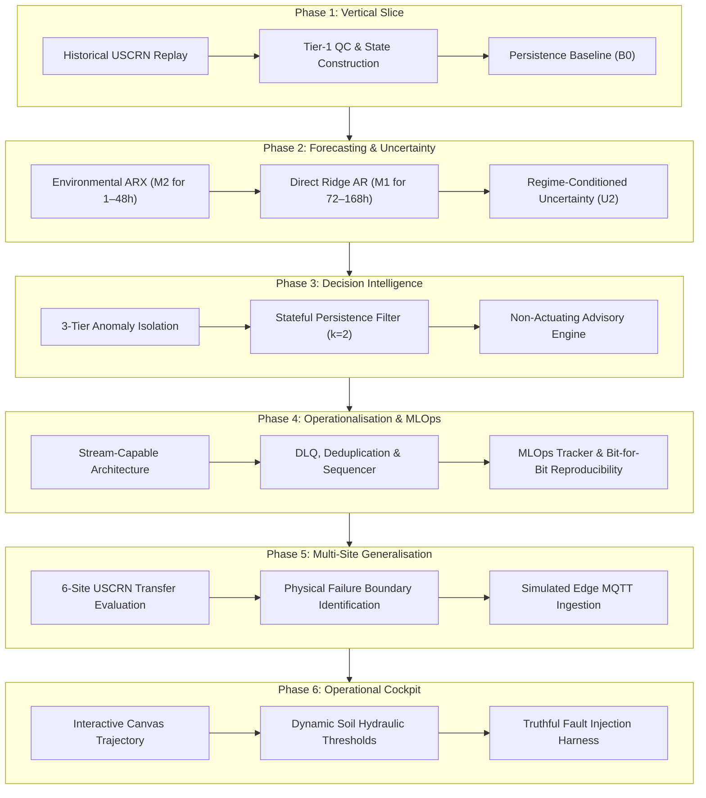
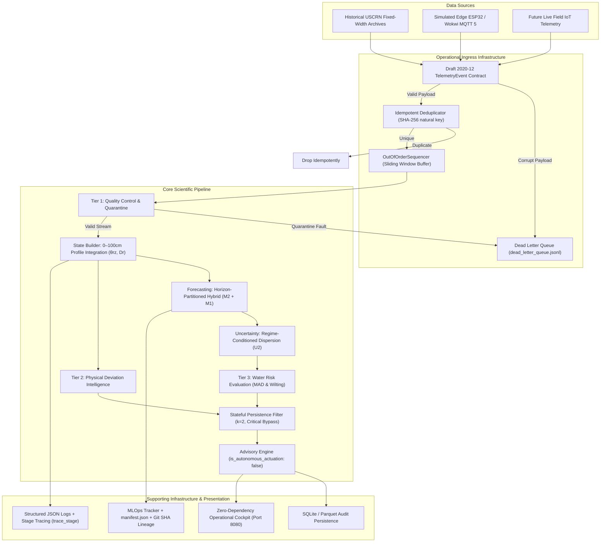
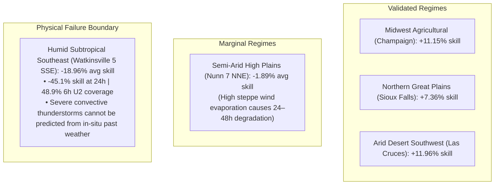

# Agri Telemetry & Forecasting Platform

**Operational time-series intelligence platform for root-zone soil water state estimation, horizon-partitioned forecasting, and uncertainty-aware agronomic decision support.**

---

## 1. Executive Summary & Problem Context

Agricultural water management requires balancing crop yield protection against resource over-application. Soil moisture sensors provide in-situ observations of volumetric water content ($\theta$), but raw sensor readings are rarely directly actionable for irrigation managers because:
1. **Raw Sensor Volatility:** Raw capacitance/TDR probes are susceptible to transient electrical noise, temperature drift, and dielectric phase transitions (frozen ground).
2. **Capillary Inertia vs. Sudden Storms:** Soil columns exhibit massive thermal and hydraulic inertia, making simple persistence hard to beat over short horizons, while multi-day drying trajectories are disrupted by unpredictable convective precipitation.
3. **Alert Fatigue & Conflation:** Systems frequently fail to separate physical sensor malfunction from genuine agronomic drought risk, producing alert storms that operators quickly ignore.

The **Agri Telemetry & Forecasting Platform** was developed as an evidence-first, contract-driven operational system that couples multi-depth soil physics with machine learning forecasting and stateful risk isolation.

---

## 2. Scientific & Architectural Progression



---

## 3. Unified System Architecture

The platform strictly separates the core scientific data pipeline from supporting operational infrastructure:



> **The system is stream-capable, not stream-dependent:** The identical processing pipeline operates across historical batch files, simulated edge IoT brokers, and future field gateways without code alteration.

---

## 4. Key Scientific Findings & Horizon Partitioning

1. **The Tough Persistence Baseline (B0):** Due to high soil capillary inertia, simple persistence achieves an MAE of $0.0007\text{ m}^3/\text{m}^3$ at 1h and $0.0047\text{ m}^3/\text{m}^3$ at 24h. Naive smoothing baselines (Climatology, EWMA) fail completely against persistence.
2. **Short-Horizon Environmental Exogenous Skill (M2):** Incorporating past rolling precipitation, solar radiation, and temperature improves 1–48h forecasts by up to **+5.7%** on root-zone moisture and **+26.4%** on shallow topsoil ($10\text{cm}$).
3. **Long-Horizon Autoregressive Mean Reversion (M1):** Exogenous weather memory decays beyond 48 hours, causing past-only weather models to degrade ($-14.0\%$ skill at 7 days). However, pure autoregression (M1) captures multi-day statistical drying trajectories, outperforming persistence by **+7.8%** at 168h.
4. **Horizon-Partitioned Hybrid Forecaster (ADR-006):** Routing M2 for 1–48h and M1 for 72–168h achieves a strictly positive out-of-sample skill envelope across all evaluated lead times.
5. **The NWP Oracle Experiment:** Feeding perfect future cumulative rainfall into the model yields a **+96.4% MSE skill gain at 7 days** ($RMSE=0.0119\text{ vs }0.0283$). This proves that **future precipitation knowledge is the primary bottleneck for multi-day soil forecasting**, but does *not* demonstrate operational NWP forecast skill.

---

## 5. Where the System Breaks / Remains Uncertain (Failure Boundaries)

A core strength of this project is its explicit mapping of operational and physical failure boundaries:



### Explicit Known Boundaries & Limitations:
- **Extended Horizons ($>48\text{h}$):** Dynamic uncertainty calibration degrades from $82\%$ at 6h to $\sim 61\%$ at 7 days because in-situ sensors cannot anticipate future storm timing. Long-horizon uncertainty remains **uncalibrated research**.
- **Subtropical Convective Storms:** In regions dominated by sudden $50\text{mm}+$ convective thunderstorm cells (`GA_Watkinsville_5_SSE`), in-situ past weather is physically insufficient. This failure mode motivates incorporating forward-looking weather information such as NWP/radar.
- **Winter Frozen Ground:** Sub-zero soil temperatures freeze liquid water into ice, lowering soil dielectric permittivity and causing flatline sensor dropouts. Tier-1 QC quarantines these readings, but irrigation models must be suspended during winter freeze.
- **Demonstration Agronomic Thresholds:** The Management Allowed Depletion ($D_{\text{MAD}}=0.50$) and Wilting ($0.85$) thresholds demonstrate software risk logic and alert suppression; they require site-specific agronomist calibration for production crop management.
- **Simulated IoT & Historical Data:** Edge telemetry is validated using simulated ESP32/Wokwi microcontroller streams stamped with `"is_simulated": true`. No live field sensors are currently deployed.

---

## 6. Master Evidence & Validation Matrix

| Claim / Component | Evaluated Scope | Evaluation Method | Authoritative Status | Known Limitations & Epistemic Boundary |
| :--- | :--- | :--- | :---: | :--- |
| **Pipeline processes real telemetry** | USCRN Lincoln 11 SW 2023 (8,760h) | Fixed-width parser & Draft 2020-12 schema validation | **VALIDATED** | Historical USCRN archives; un-interpolated point sensors. |
| **Persistence provides tough baseline** | Lincoln 11 SW 2023 H2 ($N=3,913$) | Chronological walk-forward ($h=1\dots 168\text{h}$) | **VALIDATED** | Reflects capillary inertia of silt loam soil profile. |
| **Environmental ARX improves short horizons** | Lincoln 11 SW 2023 H2 ($N=3,913$) | Multi-horizon direct ARX with past weather | **VALIDATED** | Positive for 1–48h (+5.7% root-zone, +26.4% topsoil); degrades $>48\text{h}$. |
| **Long-horizon skill unlocked by future rain** | Lincoln 11 SW 2023 H2 ($N=3,913$) | Controlled oracle ablation with future rainfall | **ORACLE-VALIDATED** | Proves theoretical value of future rain; not operational NWP skill. |
| **U2 short-horizon uncertainty calibration** | Lincoln & Multi-Site (6h leads) | Antecedent rainfall & solar demand partitioning | **PARTIALLY SUPPORTED** | Valid for 1–48h (83% wet coverage); uncalibrated research $>48\text{h}$. |
| **3-Tier anomaly & data isolation** | 8 Canonical Synthetic Scenarios | Tier-1 QC quarantine vs Tier-3 agronomic risk | **VALIDATED** | 0.0% fault leakage; 100% synthetic scenario detection. |
| **Stateful risk & advisory logic** | Full-year Lincoln & Flutter suite | Consecutive $k=2$ filter & $G=6\text{h}$ episode grouper | **TESTED** | Suppresses/groups transient alerts; thresholds require agronomic tuning. |
| **Operational event streaming pipeline** | In-Memory & Redis Streams | Replay, DLQ, Deduplication, Sequencer | **TESTED & PACKAGED** | Verified in local and containerized environments. |
| **Deterministic bit-for-bit reproducibility** | Isolated workspaces (seed 42) | End-to-end reproducibility check script | **VALIDATED** | Max MAE discrepancy $0.0000000000$ across 8,760 records. |
| **Multi-site geographic transfer** | 6 Independent NOAA USCRN Stations | Out-of-sample walk-forward transfer benchmark | **VALIDATED (Bounded)** | Demonstrated in tested Midwest/Plains/Arid; fails in subtropical convective storms. |
| **Edge IoT MQTT telemetry ingestion** | ESP32/Wokwi simulated edge stream | MQTT 5 Ingest Adapter with DLQ & Deduplication | **TESTED** | Simulated edge telemetry stamped with `is_simulated: true`. |
| **Interactive operational cockpit UI** | Browser interface on port 8080 | Headless HTTP API suite & 5-step demo runner | **LOCALLY VERIFIED** | Local operational cockpit; not a production cloud SaaS deployment. |

---

## 7. Quick Start & Execution

### 1. Run the Authoritative Test Suite
```bash
python -m pytest
```
*Executes all 75 unit, integration, and operational tests across 15 modules.*

### 2. Launch the Operational Cockpit Server
```bash
python -m agri_telemetry.cli dashboard --host 127.0.0.1 --port 8080
```
*Open [http://127.0.0.1:8080](http://127.0.0.1:8080) to access the interactive cockpit with canvas tooltips, dynamic soil hydraulic thresholds, and fault injection.*

### 3. Run the Automated 5-Step Operational Demo
```bash
python -m agri_telemetry.cli demo
```
*Executes healthy ingestion, sensor spike quarantine, duplicate packet rejection, daylight drydown tracking, and dynamic multi-site switching.*

### 4. Verify End-to-End Deterministic Reproducibility
```bash
python -m agri_telemetry.cli reproducibility-check
```
*Runs two independent pipeline executions in isolated scratch workspaces and asserts bit-for-bit metric equivalence.*
